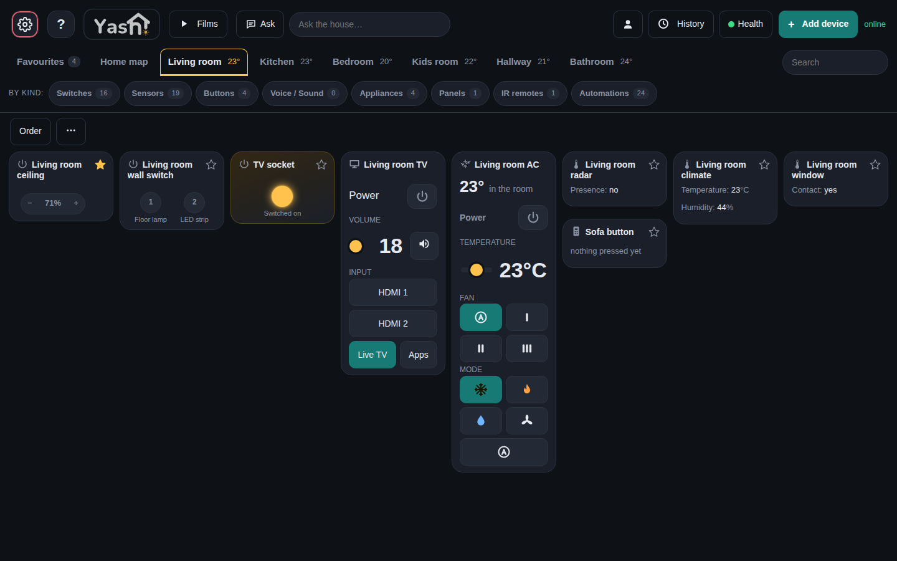
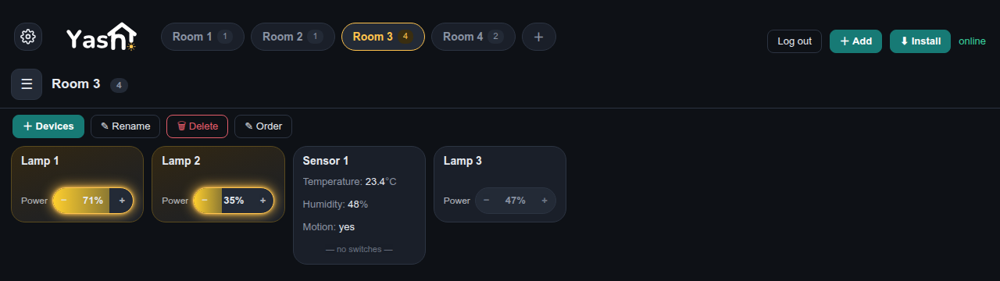
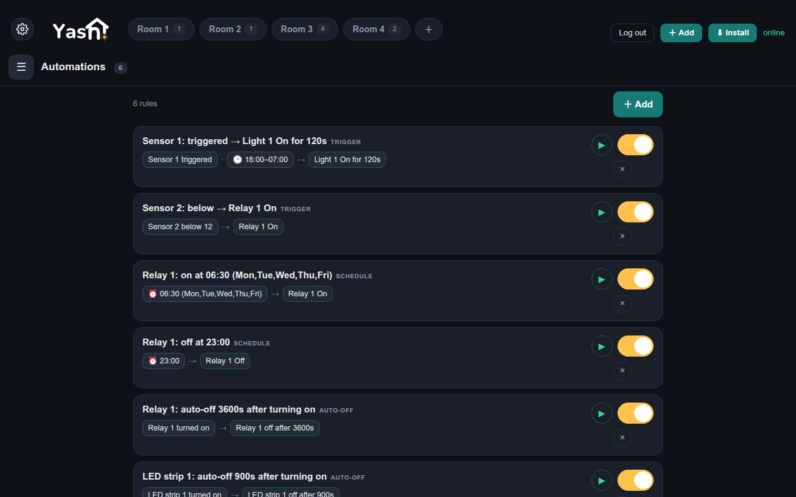
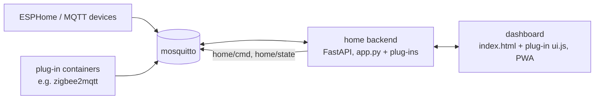
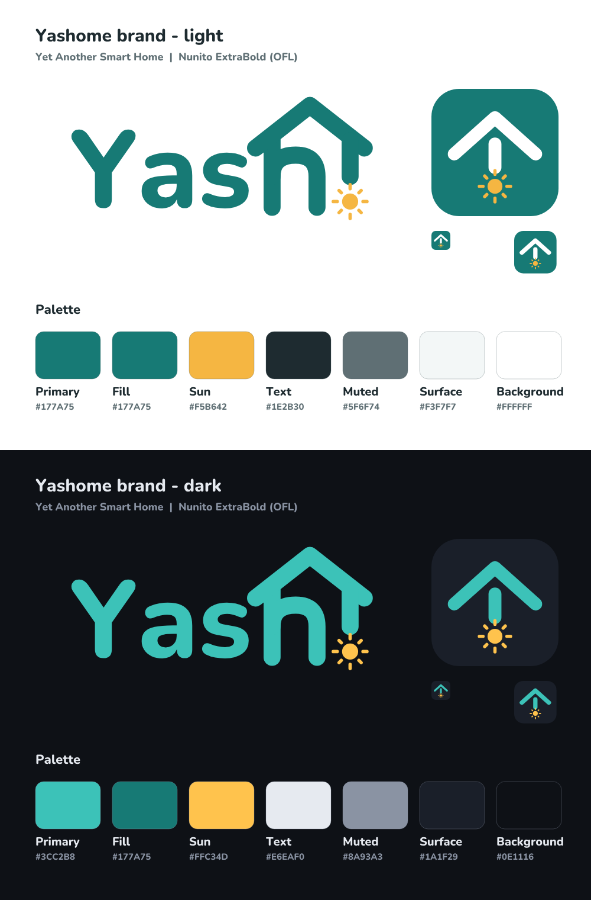

<p align="center"></p>

# Yashome -- Yet Another Smart Home

A small, local-only smart home: one Python backend, one HTML dashboard, MQTT in the middle.
Anything that speaks MQTT (ESPHome nodes, Tasmota, Shelly, your own firmware) is a few lines
of JSON. Everything else - Zigbee through zigbee2mqtt, TVs, IR blasters, cameras, a page of
your own - comes as a plug-in, with its own containers if it needs them. The plug-ins that ship are in
[`plugins/`](plugins/README.md); `.env` says which ones run.

No cloud, no accounts, no app store. The dashboard is a web page that installs as a PWA on a
phone or runs full-screen on any old tablet. Rules, schedules and auto-off timers are edited
in the same page.



## Why another one

| | Yashome | Home Assistant and friends |
|---|---|---|
| size | one backend module (`app.py` + `core/`), one page (`index.html` + `web/`), two containers (plus what your plug-ins bring) | a platform with thousands of integrations |
| how a device gets in | it publishes to MQTT; a plug-in adds whole families (Zigbee devices appear by themselves) | integration per vendor, config flow, YAML packages |
| automations | trigger, condition, action; schedule and auto-off per channel, all in the UI | scripts, blueprints, templates |
| what it takes to read the code | an evening | weeks |
| what it does not do | no vendor clouds, no cloud voice assistants, no energy dashboards, no add-on store | everything |

If you already run Home Assistant and like it, keep it. This project is for people who want a
home they can read end to end, on a Raspberry Pi or an old laptop, with a broker they own.

## Features

- **Devices from MQTT.** Generic MQTT devices are declared in `mqtt_devices.json` with their
  state and command topics, or found through ESPHome's MQTT discovery ("Add" -> ESPHome).
- **Universal command bus.** Every device is reachable as `home/cmd/<device>/<code>` and
  reports on `home/state/<device>/<code>`, whatever it speaks underneath. Scripts and other
  tools only need this one contract. In a new install only the backend account may publish to
  `home/cmd/` (`MQTT_BACKEND_ONLY`): a script uses REST `/control` or the backend account.
- **Rules without code.** A rule is a trigger (device event, time, sensor threshold), optional
  conditions and actions. Per channel: schedules ("on at 06:00 on weekdays") and auto-off
  ("switch off 60 minutes after any on"), including a manual press.
- **Rooms and favourites.** The dashboard groups by room, keeps a favourites strip, shows live
  state over a WebSocket and re-syncs itself if the broker restarts.
- **Ids that can change.** When a device's id changes in its own system, every rule, favourite,
  room and timer that referenced it moves along (`POST /api/devices/relink`, or a plug-in's own
  rename such as Zigbee's).
- **PWA.** Installs on Android and desktop, works offline for the shell, full-screen on a wall
  tablet.
- **Token-gated API.** Everything under `/api` and `/ws` requires a bearer token; without one
  configured the backend refuses every request (fail closed).
- **Plug-ins.** Another transport, a vendor integration, a tab of its own: a Python package plus
  an optional `ui.js`, loaded at start, and optionally a `setup/` folder with its containers,
  broker account, secrets and install steps. Zigbee, weather, TVs, IR, cameras, NFC cards and more
  ship with the core; `PLUGINS` in `.env` switches them on. A broken plug-in is
  logged and skipped; the house keeps running.





## Quick start

### Requirements

Any Linux box that runs Docker: a Raspberry Pi 4 (2 GB is plenty), a NUC, an old laptop. On the
host you need only:

| package | why |
|---|---|
| `docker` + the `compose` plugin (v2.20 or newer) | the services run as containers; nothing else is installed on the host |
| `git`, `make` | to fetch the repository and run the four commands |
| `curl`, `openssl` | the installer generates secrets with them, the smoke test checks the backend |

Ubuntu 24.04+: `sudo apt install git make curl openssl docker.io docker-compose-v2`. Debian and
Raspberry Pi OS do not package the compose plugin: install `git make curl openssl` with apt and
Docker itself with `curl -fsSL https://get.docker.com | sh` (it brings the plugin). Then add
yourself to the docker group (`sudo usermod -aG docker $USER`, log out and in). Other distros:
[Docker's install guide](https://docs.docker.com/engine/install/). No web server, no Python,
no Node on the host: the backend and its dependencies live in the `home` image, the dashboard
is served by the backend itself. A reverse proxy (nginx, Caddy, Traefik) is optional and only
needed for HTTPS and access from outside the LAN, see `docs/security.md`.

A plug-in may need hardware of its own (the Zigbee plug-in: a coordinator, USB stick or on the network); its
`setup/preflight.sh` checks for it during `make check`.

A host that also writes big files (an image to a USB stick, a large copy) should limit the kernel's unwritten data, for
example `vm.dirty_background_bytes = 67108864` and `vm.dirty_bytes = 268435456` in `/etc/sysctl.d/90-dirty-limits.conf`.
Without a limit, gigabytes wait to be written to the slow disk, and every small write of the backend waits behind them:
the dashboard stops answering until the copy ends.

### Install

```sh
git clone https://github.com/freidkin-michael/yashome.git
cd yashome
make check       # can this host run it? docker, ports, and each plug-in's own checks
make install
```

`make install` writes `.env` for you, creates the broker accounts, starts the containers (the
broker, the backend and whatever your plug-ins bring) and prints the dashboard URL together
with the token to paste into it. It asks only what it cannot find out itself. Generic MQTT
devices go into `mqtt_devices.json`; `examples/` has a relay, a sensor and a dimmable lamp to
copy from; the example settings add rooms, a favourite and two schedules that start disabled.

### What `make install` does, and how to change it later

All settings live in one file, `.env`, and nothing else has to be edited to get a working
system. The installer fills it in like this:

1. **`DASHBOARD_TOKEN`** and **`MQTT_PASSWORD`** are generated with `openssl rand`. The token is
   printed once at the end; the broker password is never shown, `make secrets` writes it straight
   into the broker's account file (`config/mosquitto/dynamic-security.json`, hashes only).
2. **`TZ`** is the host's time zone; schedules run in it.
3. **`MQTT_HOST`**, **`DASHBOARD_PORT`** (8765) and the user name `home` are defaults; change the
   port if something on the host already uses it.
4. **`PLUGINS`** names the plug-ins that run (`zigbee,weather`, `*` = all). On the first install
   every plug-in whose `setup/detect.sh` finds its hardware is put there: with a USB stick in
   `/dev/serial/by-id/` or a network coordinator announced over mDNS, that is `zigbee` (the only one with a `detect.sh` today). Add others by hand; Settings -> Plug-ins lists what is
   off. **`PLUGINS_EXTRA_DIR`** (default `./plugins-extra`, git-ignored) is for plug-ins of your own.
5. **Each enabled plug-in's keys**: the ones in its `setup/env.example` that `.env` lacks are
   appended, then its `setup/install.sh` fills them (the Zigbee plug-in generates its broker
   password and frontend login and picks the coordinator, a stick or a network one).
6. Optional and empty by default: **`MQTT_DEVICE_USERS`** (broker accounts for your devices, each
   with `MQTT_<NAME>_PASSWORD`; they may do everything except write the `home/state` mirror,
   publish into a plug-in's bus it marks read-only for devices, or publish what
   **`MQTT_BACKEND_ONLY`** lists - `home/cmd/#` in a new install, so a node cannot command the house)
   and **`EXTRA_PIP`** (Python packages your plug-ins need,
   `name==version`, baked into the image by `make update`).
7. **`COMPOSE_FILE`** is written for you: `docker-compose.yml` plus every plug-in's
   `setup/compose.yml`, so a plain `docker compose ...` sees the plug-ins' containers too.

Most of it needs no shell: Settings -> Plug-ins switches plug-ins and fills their keys, **Apply**
runs `make update` for you; Settings -> Update shows what a new version brings (its CHANGELOG lines),
makes a backup and updates (`git pull` + `make update`), and **Roll back** returns the code to the
version before (the house files stay; restore a backup for those). The `helper` container does this:
it holds the docker socket - root on this host - so it listens only on a network it shares with the
backend, with `HELPER_KEY`, and does only these things. Keys that name a path, a device or a broker
account of the host (`*_DIR`, `*_SERIAL`, `*_USER`, ...) are shown there but set on the host (one marked
`[network-ok]` in its `env.example`, as the Zigbee coordinator, takes a `tcp://host:port` or `none` there too). If the dashboard or the helper is down,
the shell way below always works. Update and Roll back need a plain `git clone` (a `git worktree` keeps
its repository outside the checkout, where the helper cannot see it: update such a checkout by hand).
An `https://` remote just works. An `ssh` one needs a deploy key of its own (never your `~/.ssh`), and
a remote the containers can reach (not `localhost`): `mkdir -p ~/.config/yashome/ssh`, then there
`ssh-keygen -t ed25519 -N '' -f id`, `ssh-keyscan <git host> > known_hosts`; add `id.pub` to the
repository as a read-only deploy key and run `make update` (it picks the directory up; helper/README.md
has the details). Update takes what the remote has,
unsigned: it trusts the remote.

To change anything by hand, edit `.env` and run `make update`: it re-derives the broker accounts and the
plug-ins' files from `.env`, rebuilds the backend image and lets compose recreate what changed
(the backend usually restarts, which takes a few seconds). The same command applies a new
version after `git pull`, and picks up a plug-in you added or removed. To rotate the dashboard
token, change it, `make update`, reload the page. The commands behind the installer, for a
manual setup or a different host:

```sh
openssl rand -hex 24                        # DASHBOARD_TOKEN
openssl rand -base64 18                     # each broker password
timedatectl show -p Timezone --value        # TZ
```

The stack itself runs on the wired server, but `.env` does hold Wi-Fi credentials when you set them:
`HOUSE_WIFI_SSID` / `HOUSE_WIFI_PASSWORD` (the house Wi-Fi your own nodes and the wall panels get)
and `PANELS_AP_PASSWORD` (the key of the nodes' own
`<name>-setup` APs). Keep `.env` as private as the house token. Nodes on Wi-Fi carry their own copy of
their Wi-Fi and broker credentials (ESPHome keeps them in its `secrets.yaml`).

Do not expose `:8765` to the internet directly. Put it behind a reverse proxy with TLS, and
preferably behind a VPN or an SSO portal; see `docs/security.md`.

## Signing in, and HTTPS

The dashboard asks once per device for the house token (`DASHBOARD_TOKEN` in `.env`). Easier: on a
screen that is signed in already, Settings -> Sign in from another screen shows a 6-digit code (once, 5 minutes,
5 tries; a new code replaces the one before); type it on the sign-in card the new device shows. Anyone
in the network can burn the tries - then show a new code.

Yashome runs on plain HTTP inside the house network. Two things follow: the token travels in clear
on your Wi-Fi (keep guests on a separate network), and browsers refuse what they keep for secure
pages - the dashboard is not installable as an app (use "Add to home screen", a shortcut), and a USB
flash from the browser (when it ships with the panels) needs a secure page: http://localhost on the
Yashome computer, or an HTTPS name. If you want HTTPS anyway, put a reverse proxy in front, e.g. Caddy
with its own certificate authority:

    yashome.home.arpa:8443 {
        tls internal
        reverse_proxy 127.0.0.1:8765
    }

and trust Caddy's root certificate on every device (Android: Settings -> Security -> Install a
certificate). With `BIND_ADDRESS` set (`.env`), use that address instead of 127.0.0.1. The plain
:8765 stays open beside it: the panel launcher and a build server on another
computer use it (apps do not trust such certificates). The Yash! app (plug-in family) talks plain
http to `:8765` on your own network or VPN; from the internet it needs HTTPS with a publicly trusted
certificate (a domain of your own) - see plugins/tools/family/README.md.

## Backups

The backend makes a backup every night (`BACKUP_AT`, default 03:30 in the `TZ` of `.env` - UTC
without it; `off` for none) into `backups/` and keeps the last 14 (`BACKUP_KEEP`): the house files
(HOUSE_DIR, or the house files of this checkout), `.env`, zigbee2mqtt's data without its log (the
coordinator's network key: without it every Zigbee device is paired again) and your own plug-ins.
Runtime state (pending timers, the status cache) stays out: restored days later it would replay old
commands. A zigbee2mqtt folder the backend cannot reach, and files it may not read (left out), are
shown as warnings in Settings. Settings -> Backups shows the age of the last one (red after two
days), makes one now, downloads them and restores one (from the list or from an uploaded file; the current
state is backed up first). `make backup` makes one from the shell.

A backup holds every secret of the house: keep a copy on another disk or computer (a USB stick, a
NAS) - a backup on the disk that dies is no backup. To restore: Settings -> Backups -> Restore, or from
the shell (on this computer or a new one with
this repository checked out; Z2M_DATA_DIR and PLUGINS_EXTRA_DIR come from the backup's .env,
HOUSE_DIR stays this computer's): `make restore FILE=backups/yashome-backup-<time>.tar.gz`. It stops
the house, puts the current files aside as `*.pre-restore-<time>` (nothing is deleted) and starts it
again. Host pieces of plug-ins (e.g. /etc/yashome/presence.env) are not in it.

Moving to a new server: restore a backup there, or copy at least `.env` and `plugin-state/` (in
HOUSE_DIR) by hand. `.env` holds what the nodes in the house were built with: `PANELS_OTA_PASSWORD`, the
broker device accounts (`MQTT_DEVICE_USERS`, `MQTT_<NAME>_PASSWORD`), `HOUSE_WIFI_*` and
`PANELS_AP_PASSWORD`. With them, every node that comes online takes new firmware by OTA (a new broker
address, say). Without the old `.env` the OTA password no longer matches: every node needs a reflash over
the cable.

## Architecture



Two containers of the core, plus the plug-ins' own:

| service | what | port |
|---|---|---|
| `mosquitto` | the broker; authenticated, one account per client kind | 1883 (LAN, `MQTT_PORT`) |
| `home` | backend + dashboard; config in JSON files next to it | 8765 (`DASHBOARD_PORT`) |
| a plug-in's, e.g. `zigbee2mqtt` | from the plug-in's `setup/compose.yml` | its own |

The backend keeps its configuration in `settings.json` (names, rooms, rules, favourites) and
`mqtt_devices.json` (generic devices), both plain JSON, both safe to edit by hand while the
stack is stopped. Each plug-in keeps its own files and settings in `plugin-data/<name>/`, and what
it writes itself (paired keys, counters) in `plugin-state/<name>/`. All of them sit next to the
code unless `HOUSE_DIR` in `.env` names a directory of their own (for example a private git
repository of your house beside the checkout; `make move-house` moves an existing house there, and
`examples/house.gitignore` keeps the runtime state and `plugin-state/` out of git): then the code
and your house are updated and backed up apart, and the backend behaves the same. zigbee2mqtt's
network (`Z2M_DATA_DIR`) stays under the checkout either way - back it up with it. A
`compose.override.yml` in the house directory is added to the stack (`make update` lists it in
`COMPOSE_FILE` after the plug-ins' files): the place for what only your house has, such as the
Docker network of a reverse proxy and an alias on it (relative paths in it count from the checkout).
State lives in the broker as
retained messages; the backend mirrors every device into `home/state/...` so a script never needs
to know the vendor topic. It also sends the house clock every minute, retained: `home/clock/time`
("HH:MM", in `TZ`) and `home/clock/date` (in the house language) - wall panels and ESP clocks print them.

A **plug-in** is a Python package (plus an optional `ui.js` and `i18n.json`) in `plugins/` of the
checkout, or of your own in `PLUGINS_EXTRA_DIR`, which compose mounts read-only into the `home`
container; `PLUGINS` in `.env` says which of them load. The core does not know any plug-in by
name; it offers hooks (transports and their rule shortcuts, MQTT topics and a namespace of its
own, rule actions, settings sections; on the dashboard tabs, the "Add" menu, card decorations or
whole card faces, a box in the header, a section of the device modal) and a plug-in registers
itself on them. A plug-in keeps its own files in `plugin-data/<name>/`, which git ignores: the
package holds code and empty templates, your house's data never lives in it. Settings ->
Plug-ins lists what loaded and what failed, with the error. Only a plug-in's `ui.js`,
`i18n.json` and `static/` files are served without the token; everything else it adds needs it.
To write one, start from `plugins/_example/` (copy it as `hello` into `PLUGINS_EXTRA_DIR`, add
`hello` to `PLUGINS`, `docker compose restart home`); the full contract is in
[docs/plugins.md](docs/plugins.md), the shipped ones are listed in [plugins/README.md](plugins/README.md).
Every environment key, the `.env` ones and those the containers set themselves: [docs/environment.md](docs/environment.md).

Details: [MQTT contract](docs/mqtt-contract.md), [REST API](docs/rest-api.md),
[rules engine](docs/rules.md), [plug-ins](docs/plugins.md), [security model](docs/security.md),
[device state: live, waiting, offline](docs/device-state.md) (agreed design, being implemented),
[device description: what a firmware built by fwgen tells the house](docs/device-description.md) (design, no code yet),
[pairing a fwgen device: the house side](docs/pairing.md) (design, no code yet),
[voice: hearing today, answering as the target](docs/voice.md) (design, no code yet).

## What it works with

- **Anything that already speaks MQTT** -- Tasmota, Shelly (MQTT mode), OpenBeken, ESPHome nodes
  with your own firmware, a script on a Raspberry Pi. You describe the topics once in
  `mqtt_devices.json` (see below) or let "Add" -> ESPHome read the node's MQTT discovery. Wi-Fi
  onboarding is the device's own business (Tasmota and Shelly have their setup portals, ESPHome
  its captive portal).
- **Zigbee** -- anything zigbee2mqtt supports, several thousand devices, through the `zigbee`
  plug-in: it brings the zigbee2mqtt container, pairing from "Add", renaming a device's key with
  every reference following, and removing it from the network.
- **Anything else you write a plug-in for** -- a device with its own protocol, a LAN API, a page
  of your own; see [docs/plugins.md](docs/plugins.md).
- **Not:** anything that lives behind a vendor cloud.

## Tested hardware

- **Server:** a small x86 box running Docker; a Raspberry Pi 4 is enough.
- **Zigbee (plug-in):** a coordinator zigbee2mqtt supports, a USB stick or a network one (SMLIGHT SLZB,
  ZigStar: `Z2M_SERIAL=tcp://host:port`), on its `ember` (Silicon Labs EFR32) or `zstack` (TI CC2652) adapter.

## Command line: yashctl

`tools/yashctl` drives the house from a shell through the same REST API the dashboard uses; it
reads `DASHBOARD_TOKEN` and `DASHBOARD_PORT` from the checkout's `.env` (or `YASHOME_TOKEN` /
`YASHOME_URL`, `--dir` / `YASHOME_DIR` for another checkout; `--token` works too but shows in `ps`).
Python 3 only, no packages. Put it on your `PATH` with `ln -s "$PWD/tools/yashctl" ~/.local/bin/yashctl`.

```sh
yashctl status                      # backend, broker, plug-ins (exit 1 if unhealthy)
yashctl devices --room "Room 1" --state
yashctl show lamp_1                 # channels, their values and how to set them
yashctl on lamp_1 ; yashctl toggle relay_1
yashctl set lamp_1 brightness 50    # brightness in percent, 0-100
yashctl watch sensor_1              # its state on every change; --events for presses and triggers
yashctl rules ; yashctl rule disable 'a|relay_1/power|inch' ; yashctl rule delete --yes '<id>'
yashctl plugins ; yashctl rooms ; yashctl favorites ; yashctl events lamp_1 ; yashctl resync
yashctl --json devices              # the API's JSON, for scripts
yashctl plugin on panels ; yashctl key FAMILY_APP_ID org.example.yash ; yashctl key FAMILY_APP_ID ""   # "" removes it
yashctl apply --wait                # make update through the helper, followed to the end
yashctl version ; yashctl update --wait ; yashctl rollback --wait ; yashctl job
```

`plugin`, `key`, `apply`, `update`, `rollback` and `job` go through the helper, like Settings does (one
job at a time, whoever starts it). If the dashboard or the helper is down, `make update` on the host
still does it all.

Exit codes: 0 ok, 1 unhealthy (`status`, `plugins`), 2 usage or a value it cannot use, 3 no such device, room,
channel or rule (any HTTP 404), 4 unreachable, 5 another HTTP error.

## Adding a generic MQTT device

Generic devices are described in **`mqtt_devices.json` in the repository root**, next to
`docker-compose.yml` (or in `HOUSE_DIR` when set); the `home` container sees it as `/house/mqtt_devices.json`. `make install`
creates it from `examples/mqtt_devices.json` if it does not exist, and the file is git-ignored,
so `git pull` never touches your devices. Its sibling `settings.json` (names, rooms, rules,
favourites) is written by the dashboard itself; you do not edit it by hand. One entry per
device:

```json
{
  "id": "relay_1",
  "name": "Relay 1",
  "category": "switch",
  "controls": [
    {"kind": "switch", "code": "power", "label": "Power",
     "state_topic": "relay_1/relay/state", "command_topic": "relay_1/relay/command",
     "payload_on": "ON", "payload_off": "OFF"}
  ]
}
```

Then `docker compose restart home` and the tile is there, with schedules and auto-off
available from its settings dialog. `examples/mqtt_devices.json` shows a sensor channel as well.

Where the values come from:

- **`id`** -- your own short name, Latin letters, digits and `_ . -`; it becomes part of the
  universal bus topics (`home/cmd/relay_1/power`). Do not change it later, rules refer to it (if
  you must, `POST /api/devices/relink` moves them).
- **`name`** -- what the dashboard shows. Rooms are not a device field: put devices into rooms
  in the dashboard itself (the "+" chip next to the room names).
- **`category`** -- the dashboard tab: `switch`, `sensor`, `button`, `indicator`; anything
  else lands under "Other".
- **`code`** -- the channel name inside the device (`power`, `brightness`, `temperature`).
  A device may have several channels, one entry per channel. **`label`** is what the channel
  is called on the card.
- **`kind`** -- `switch` (on/off), `bright` (a level with `min`/`max`), `sensor` (a number or
  a `vtype: bool` yes/no to display), `sensor_text`, `setting_enum`.
- **`state_topic`**, **`command_topic`**, **`payload_on`/`payload_off`** -- from the device's
  documentation. Tasmota: `stat/<topic>/POWER` and `cmnd/<topic>/POWER` with `ON`/`OFF`; Shelly
  Gen1: `shellies/<id>/relay/0` and `.../relay/0/command` with `on`/`off`; ESPHome: whatever the
  node's `state_topic`/`command_topic` say. When in doubt, listen to the broker and press the
  physical button on the device: the topic that changes is the state topic.

  ```sh
  sed -n 's/^MQTT_PASSWORD=//p' .env | docker compose exec -T mosquitto sh -c \
      'f=$(mktemp); trap "rm -f $f" EXIT; printf -- "-P %s\n" "$(cat)" > "$f"; mosquitto_sub -o "$f" -u home -v -t "#"'
  ```

  Sensors need only `state_topic`; add `unit` (`%`, `W`, `\u00b0C` in JSON) for the display. A device may
  also publish one JSON object with all its values on a device-level `state_topic`; the full
  field list is in [docs/mqtt-contract.md](docs/mqtt-contract.md).

## Language

The dashboard is written in English; Russian ships as a dictionary in `i18n.js` and the
browser's language picks it (the gear button, Settings, switches and remembers). Adding a
language is one more table in that file - no Russian, or any other language, lives in the code
except the localization code itself (a transliteration table, plural forms), marked with an i18n comment.
A plug-in brings its own words in `i18n.json`; it can add words, never re-word the core's.

## Wiring

Which switch channel feeds what is one fact in one file, `wiring.json` of the house: `[{id, switch: {dev, code}, target: {dev} |
{load, seg?}, note}]`. The IR appliance's **Powered from** (a fixture behind a wall switch) is an entry with a `dev` target; the map's
**What it turns on** and a lamp's links are entries with a `load` target (a lamp on the map; `seg` = a part of a strip). The map
draws them as the **Wires** layer; **IR and radio** is the other one (rules, panels, IR blasters); each layer is kept on or off per
browser. `GET/PUT /api/wiring` (house key); the core keeps the list (docs/plugins.md).
The map's links and the IR appliances' power are taken over once, each at the first start its plug-in is on: the files they come from are
copied with their sha256 (`manifest.txt`) to `backups/wiring-migration-<UTC time>-<plug-in>/` first (a read-only checkout, the
demo: to `plugin-state/` of the house; neither writable: that plug-in's migration waits for the next start, its old copy stays in
charge and Health says so in yellow), every entry is kept (one whose device is
not loaded yet too, merged by key), and `.wiring-migrated` marks that plug-in done; Settings -> Health shows the counts. With the marker there, a lost or
broken `wiring.json` is never rebuilt from the old copies: the house runs with no wiring, the broken file is kept as
`wiring.json.bad-<time>`, Health turns red, and changes are refused (409) until the file is put back. A wiring entry goes only when
its owner removes it (unlinks the lamp, clears **Powered from**, deletes the tile or the lamp), not when a device disappears;
when a device's key changes (renamed in zigbee2mqtt, a relink), its entries move to the new key.
A plug-in that was taken over reads `wiring.json` only. Its old fields (`links` in map.json, `power` of an IR appliance) stay as they
were at the takeover and are not written again. An older version with the wiring list rewrites them from `wiring.json` at its
start; a version from before the wiring list reads them as they were, so the wiring changes made since are missing there.

## Help

There is one **?**, in the header. A tap (or Enter) opens every hint as a sheet: a search over the titles and texts, grouped by
screen, and **Show** on each, which opens that screen (a tab, a Settings page; a device window must be open already) and pulses the
control. Dragged, the **?** turns green over a control that has an entry, with its title above the finger (on touch it rides 56 px
above it, so the finger does not hide the control); let go there, it shows the title and one to three lines, and **More** opens the
sheet at it. The first visit wiggles it once with a word on both ways (`localStorage` `help.tip`).
One list feeds both: `HELP` in `web/js/20-help.js` and a plug-in's `help` (docs/plugins.md), each entry `{id, screen, sel, title, text, more?,
at?}`: `sel` finds the control, its first visible match (the first channel of a device, say); `at: 'label'` lets its row's label (or
the label line above a field) stand for it too. **Show** opens a tab or a Settings page (a plug-in's page by its
English title); a device window or a plug-in's own window (`screen` of its own, `screenName` its title in the sheet) only when it is
open already, since opening one may start something (pairing). A plug-in toolbar button with `help: {text}` gets its entry. The
texts are English keys with the Russian in `i18n.js` (a plug-in's in its `i18n.json`). The panel view (tablets, ESP screens) has none.
`tests/plugins/test_help.py` checks the list; `tests/plugins/test_help_ui.py` the tap, Enter, a mouse drag and a touch drag;
`tests/ui_sweep.py` that every entry's control shows on some screen and that the sheet and popover lie above a window (its house gets
the devices, tablets, panels and IR remote of `tests/ui_sweep_house/`).

## Development

Four commands, in the order you will need them:

```sh
make check     # preflight: docker + compose, free ports, openssl, curl, your user in the
               # docker group, then each plug-in's setup/preflight.sh. Changes nothing.
make install   # first run: writes .env, creates broker accounts, starts everything
make test      # unit tests plus a smoke test against the running stack (broker reachable,
               # backend answers with the token, then each plug-in's setup/smoke.sh)
make update    # after editing .env, git pull or a plug-in change: re-derive secrets, rebuild, recreate
```

`make move-house` moves the house files of this checkout into `HOUSE_DIR` (set it in `.env` first).
After `git pull` of a checkout of the first 2.0.0 cut (with plug-ins straight in `plugins/`) run
`make update` before anything else (python3 on the host, as `make check` says): it rewrites
`COMPOSE_FILE` for the plug-ins' new group folders; the first start then moves the plug-ins'
settings sections and the nfc / webOS files to their new places by itself.
Going back to an older core: stop the stack and move `plugin-state/<name>/*` back into
`plugin-data/<name>/`, and each `plugin-data/<name>/settings.json` section into `settings.json`, removing
that file (an older core does not read them where they are now; without the nfc counters it refuses
every tap; a plug-in file left behind would win over what you change on the older core).
Coming back up again keeps the `plugin-state/` copy of a file; a TV paired while on the older core is
paired again (its key is kept aside as `webos_keys.json.migrated-<time>`).

`make lint` (ruff, py_compile, JS syntax, JSON, `sh -n`, and `tools/check_plugins.py`: ASCII, no
LAN address, MAC or home directory in `plugins/`, none of your house's words, Russian only in
translations, known group folders, unique names and resolvable `requires`) and `make dev-test` (every test outside docker,
the core's and the plug-ins' in `tests/plugins/`) are what CI runs on every push. The two run apart: the
plug-ins' harness loads every shipped plug-in into the one app, so `pytest tests` runs the core's only and
`pytest tests/plugins` the plug-ins' (`tests/conftest.py`). `tests/ui_sweep.py` (also a test, with Chrome) opens every window, sheet,
settings page, tab and map sheet (and, on its own copy of a house, the Panels cards, the Android tablets window and the IR remote, button
and tile windows: what `tests/fixtures` lacks comes from `tests/ui_sweep_house/`) at 360, 600 and 1280 px and fails on a label under its field, squeezed to no width or clipped; run it on
a copy of a house's data (`python tests/ui_sweep.py <house dir>`) or read-only on a running house (`SWEEP_URL=http://.../?token=...`, no
Add window). The panel firmware generators' output is
pinned file by file (`tests/plugins/test_panels_golden.py`): after a change on purpose, run it with
`--dump DIR` to read the new YAML and `--update` to take it. `tools/stand.py` starts a throwaway broker
and backend with made-up devices to try how a device that goes away and comes back is shown
(docs/device-state.md). What changed in
each release is in [CHANGELOG.md](CHANGELOG.md).

The whole backend is one module, `app.py`, whose code is in `core/` one file per area (`app.CORE_PARTS`, run in
app's own namespace, so plug-ins and tests see one module); the dashboard is `index.html` with its style in
`web/app.css` and its one script in `web/js/` (served joined as `/app.js`, `tools/webpage.py`). Pull requests
welcome, but read the code first: the point of the project is that you can.

## Brand

The wordmark, icon and palette live in [`branding/`](branding/README.md) (Nunito, OFL); `branding/brand.py`
regenerates every asset. 

## License

MIT, see `LICENSE`. The voice feature downloads the Silero speech models, which are CC BY-NC-SA 4.0: Yashome is for
non-commercial use only, see `NOTICE.md`.
